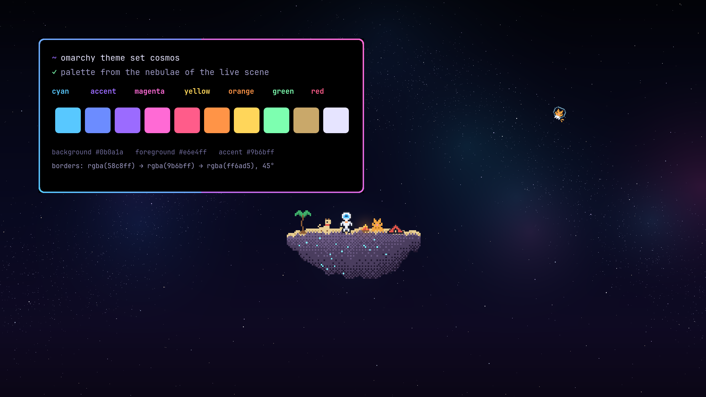

# Tema Cosmos para Omarchy

**Azul noche y violeta, con bordes de nebulosa y fondos espaciales en pixel art.**

[English](README.md)



La paleta sale de las nebulosas de [Cosmos](https://github.com/lnavarrocarter/omarchy-cosmos), una escena espacial viva
en pixel art para Omarchy. El tema funciona solo, con fondos fijos; instala también el plugin para tener la versión
animada.

## Instalación

```bash
omarchy theme install https://github.com/lnavarrocarter/omarchy-cosmos-theme
```

Se aplica de inmediato. Para volver a él más tarde: `omarchy theme set cosmos`.

Para animar el escritorio:

```bash
omarchy plugin add https://github.com/lnavarrocarter/omarchy-cosmos --enable
```

## Qué incluye

- **`colors.toml`**: la paleta, que Omarchy convierte en los colores de terminales, barra, menús, notificaciones, btop,
  Neovim y editores.
- **Bordes de ventana**: un degradado de nebulosa cian, violeta y magenta alrededor de la ventana activa, y un índigo
  tenue en las demás.
- **`backgrounds/`**: tres escenas 4K dibujadas con los mismos sprites de la escena animada: el planeta, la isla del
  náufrago y la estación. La pantalla de bloqueo también las muestra.
- **`unlock.png`**: la imagen de la pantalla de arranque, el planeta junto a la isla. Se aplica con
  `omarchy plymouth set by theme cosmos` (pide sudo).
- **`icons.theme`**: íconos Yaru morados.

## Opcional: vidrio y animaciones warp

Omarchy no carga Lua de temas instalados desde git, así que la parte de Hyprland del aspecto es opcional. Agrega:

- vidrio esmerilado sobre el fondo y sombras violeta;
- ventanas que aparecen con un leve rebote;
- escritorios que se deslizan en vertical, y un borde de nebulosa que gira despacio.

Con el plugin Cosmos, además, las estrellas se estiran al cambiar de escritorio.

```bash
cp ~/.config/omarchy/themes/cosmos/extras/hypr/cosmos.lua ~/.config/hypr/cosmos.lua
```

Después agrega `require("hypr.cosmos")` a `~/.config/hypr/hyprland.lua`, a continuación de `require("hypr.looknfeel")`.
Para volver atrás, quita esa línea. Lee antes [`extras/hypr/cosmos.lua`](extras/hypr/cosmos.lua); es corto.

## Regenerar las imágenes

Los fondos y `unlock.png` los dibuja `tools/render-backgrounds.js`, en el repositorio del plugin:

```bash
node tools/render-backgrounds.js out 1920 1080
magick out/2-cosmos-castaway.png -filter point -resize 200% backgrounds/2-cosmos-castaway.webp
```

## Licencia

[MIT](LICENSE) © lnavarrocarter
