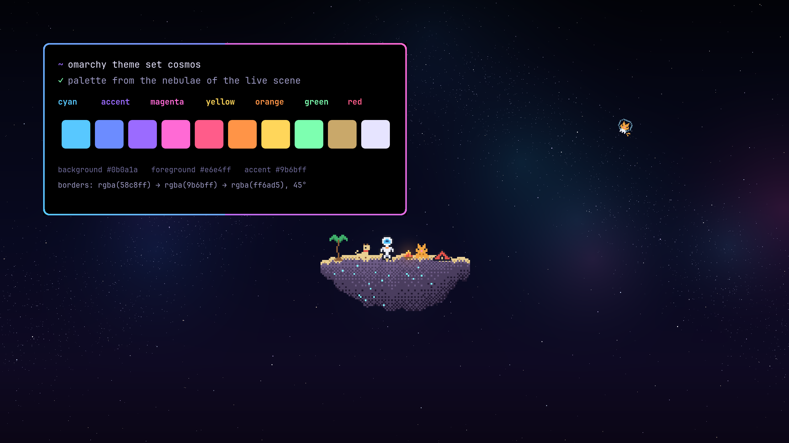

# Cosmos theme for Omarchy

**Night-blue and violet, with nebula window borders and pixel-art space backgrounds.**

[Español](README.es.md)



The palette comes from the nebulae of [Cosmos](https://github.com/lnavarrocarter/omarchy-cosmos), a living pixel-art
space scene for Omarchy. The theme works on its own with still backgrounds; install the plugin too for the animated
version.

## Install

```bash
omarchy theme install https://github.com/lnavarrocarter/omarchy-cosmos-theme
```

That applies it right away. Switch back to it later with `omarchy theme set cosmos`.

To animate the desktop:

```bash
omarchy plugin add https://github.com/lnavarrocarter/omarchy-cosmos --enable
```

## What's included

- **`colors.toml`**: the palette, which Omarchy turns into terminal, bar, menu, notification, btop, Neovim and editor
  colours.
- **Window borders**: a cyan, violet and magenta nebula gradient around the focused window, a dim indigo around the
  rest.
- **`backgrounds/`**: three 4K scenes drawn from the same sprites as the live scene: the planet, the castaway island and
  the station. The lock screen shows them too.
- **`unlock.png`**: the boot screen artwork, the planet beside the island, applied with
  `omarchy plymouth set by theme cosmos` (needs sudo).
- **`icons.theme`**: Yaru purple icons.

## Optional: glass and warp motion

Omarchy does not load Lua from themes installed from git, so the Hyprland part of the look is opt-in. It adds:

- frosted glass over the background and violet shadows;
- windows that pop in with a slight overshoot;
- workspaces that slide vertically, and a nebula border that slowly turns.

With the Cosmos plugin, stars also streak when you switch workspace.

```bash
cp ~/.config/omarchy/themes/cosmos/extras/hypr/cosmos.lua ~/.config/hypr/cosmos.lua
```

Then add `require("hypr.cosmos")` to `~/.config/hypr/hyprland.lua`, after `require("hypr.looknfeel")`. Remove that line
to go back. Read [`extras/hypr/cosmos.lua`](extras/hypr/cosmos.lua) first; it is short.

## Rebuilding the art

The backgrounds and `unlock.png` are rendered by `tools/render-backgrounds.js` in the plugin repository:

```bash
node tools/render-backgrounds.js out 1920 1080
magick out/2-cosmos-castaway.png -filter point -resize 200% backgrounds/2-cosmos-castaway.webp
```

## License

[MIT](LICENSE) © lnavarrocarter
